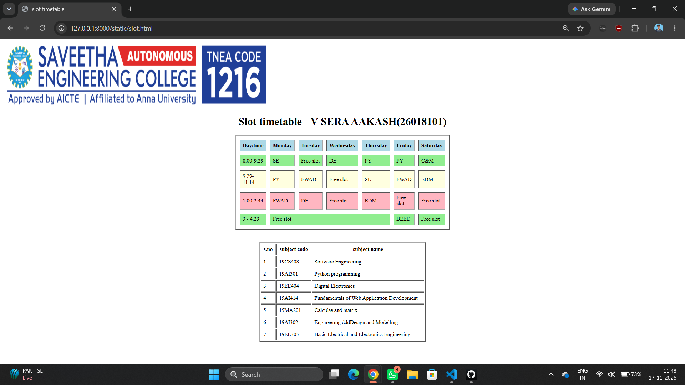

# Ex04 Time Table
## Date:17-11-2026

## AIM
To write a html webpage page to display your slot timetable.

## ALGORITHM
### STEP 1
Create a Django-admin Interface.

### STEP 2
Create an App inside the Django project.

### STEP 2
Create a static folder uder the created App and insert HTML code.

### STEP 3
Create a simple table using ```<table>``` tag in html with the relevant attributes.

### STEP 4
Add rows using ```<tr>``` tag.

### STEP 5
Add your course schedule using ```<td>``` tag.

### STEP 6
Execute the program using runserver command.

## PROGRAM
```
<html>
    <head>
        <title>slot timetable</title>
    </head>
    <body style="bgcolor="black"">
         <br>
    <h1 align="center">Slot timetable - V SERA AAKASH(26018101)</h1>
     <table border="4" cellspacing="12" cellpadding="7" align="center" width="500" height="200">
        <tr bgcolor="lightblue">
            <th><b>Day/time</b></th>
            <th>Monday</th>
            <th>Tuesday</th>
            <th>Wednesday</th>
            <th>Thursday</th>
            <th>Friday</th>
            <th>Saturday</th>
        </tr>
        <tr bgcolor="lightgreen">
            <td>8.00-9.29</td>
            <td>SE</td>
            <td>Free slot</td>
            <td>DE</td>
            <td>PY</td>
            <td>PY</td>
            <td>C&M</td>
        </tr>
        <tr bgcolor="lightyellow">
            <td>9.29-11.14</td>
            <td>PY</td>
            <td>FWAD</td>
            <td>Free slot</td>
            <td>SE</td>
            <td>FWAD</td>
            <td>EDM</td>
        </tr>
        <tr bgcolor="lightpink"> 
            <td>1.00-2.44</td>
            <td>FWAD</td>
            <td>DE</td>
            <td>Free slot</td>
            <td>EDM</td>
            <td>Free slot</td>
            <td>Free slot</td>  
        </tr>
        <tr
            <tr bgcolor="lightgreen">
            <td> 3 - 4.29</td>
            <td colspan="4">Free slot</td>   
            <td>BEEE</td>
            <td>Free slot</td> 
        </tr>
    </table> 
    <br>
    <br> 
    <table border="4" cellspacing="3" cellpadding="7" align="center" width="500" height="200">
        <tr>
            <th><b>s.no</b></th>
            <th>subject code</th>
            <th>subject name</th>
        </tr>
        <tr>
            <td>1</td>
            <td>19CS408</td>
            <td>Software Engineering</td>
        </tr>
        <tr>
            <td>2</td>
            <td>19AI301</td>
            <td>Python programming</td>
            
        </tr>
        <tr> 
            <td>3</td>
            <td>19EE404</td>
            <td>Digital Electronics</td>
              
        </tr>
        <tr>
            <td>4</td>
            <td>19AI414</td>
            <td>Fundamentals of Web Application Development</td>
        </tr>
        <tr>
            <td>5</td>
            <td>19MA201</td>
            <td>Calculas and matrix</td>
        </tr>
        <tr>
            <td>6</td>
            <td>19AI302</td>
            <td>Engineering dddDesign and Modelling</td>
        </tr>
        <tr>
            <td>7</td>
            <td>19EE305</td>
            <td>Basic Electrical and Electronics Engineering</td>
           </tr>
    </table>
    </body>
</html>
```

## OUTPUT


## RESULT
The program for creating slot timetable using basic HTML tags is executed successfully.
